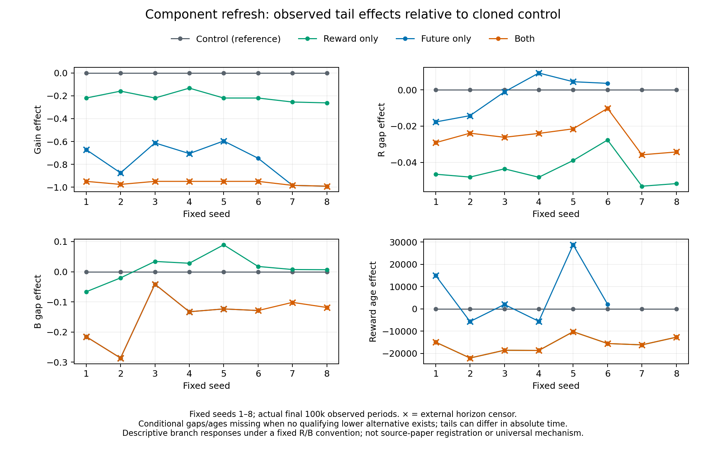

# Memoryless pricing: cloned-state component refresh

**Completed:** 2026-10-10. **Classification:** exploratory mechanism diagnostic. **Baseline:** `e49fdfecbc77c0f2eb8330011380d10e52f0e78e`. Production runtime source is unchanged.

The user approved digging further into the [first diagnostic](2026-10-10-memoryless-pricing-diagnostic.md): does refreshing immediate-profit history or future-credit history more effectively dismantle the high-price pattern? Eight memoryless learners were replayed to one million completed periods and cloned into four continuations. Learning rate, discount factor, random streams and inherited counters were held at the common fork. Scope, accounting convention, analysis rules, source and executable were frozen before execution.

## Finding

Refreshing residual future credit lowered observed prices more than refreshing immediate-profit estimates in every seed. Refreshing both produced the largest reduction. Profit-only feedback helped, but its profit component already favored a lower price while stale future credit still outweighed it in the combined score. This identifies a concrete contribution to the ranking problem under the defined accounting convention.

The discount factor remained 0.95. This is evidence about how different price entries receive updates, rather than evidence that caring about future profit inherently causes high prices. The learner has one state: its current continuation target is common to every action. Differently dated continuation contributions can nevertheless give the often-chosen price a larger stored future-credit allowance.

## Approved branches and component definition

Seeds 1–8 use original memory 0/asynchronous defaults: two firms, 15 prices, alpha 0.15, delta 0.95, exponential exploration beta 4e-6, Calvano initialization, lowest-price ties and project RNG. Every prefix reached exactly 1,000,000 periods. Its complete native world, serialized 128-bit RNG, component tracker and stability counter were cloned four ways. Both-feedback changes the native update flag only after equal fork checkpoints are saved; no counter or exploration reset occurs.

The original learner stores only a total score `Q`. Our specified decomposition is `Q = R + B`:

- Initially `R = (1-delta)*Q`, the immediate-reward contribution implied by Calvano initialization; `B = Q-R`.
- For every chosen action, retain the exact original total-score update `Q_new = Q_old + alpha*(reward + delta*V_pre - Q_old)`. Update `R` toward current reward with alpha, and retain `B` as the residual `Q-R`.
- All action targets use the same frozen pre-write world. `V_pre` is the learner's estimate, not certified true future value.

| Branch | Extra updates for unchosen prices |
| --- | --- |
| Control | None |
| Profit only (`reward`) | Increment Q and R by `alpha*(current_counterfactual_reward-R)`; B unchanged in real arithmetic |
| Future only (`future`) | Increment Q by `alpha*(delta*V_pre-B)`; R unchanged and B retained as residual |
| Both | Exact native synchronous total-Q formula and reward EMA; B residual |

Every chosen price naturally updates both components in all branches. The opposite component is withheld only from **extra unchosen-price refreshes**, not frozen globally. Subsequent choices, rival payoffs and both histories therefore interact. B is a specified residual accounting component, not an independently measured true forecast. Reward-only residual B can drift by floating ulps; the maximum recorded drift and decomposition error were 8.88e-16, far below the observed score gaps.

The frozen semantic labels `reward_only`/`future_only` correspond to saved directory aliases `reward`/`future`, as documented in the pre-run schema. These are the same approved treatments.

## Exposure, stopping and observation

Each branch was limited to one million additional periods and absolute period 2,000,000. Native cap 1,000,000,000 and convergence window 100,000 remained unchanged. Inherited stability counters were not reset; early finishes and external censoring were retained. Actual simulation cost was 37,468,735 periods: 8,000,000 shared-prefix periods plus 29,468,735 continuation periods, below the approved 40,000,000 maximum. Continuation-only statistics exclude prefix exposure.

| Branch | Native finishes | Horizon-censored |
| --- | ---: | ---: |
| Control | 5 | 3 |
| Profit only | 8 | 0 |
| Future only | 3 | 5 |
| Both | 0 | 8 |

All 32 branches contain a complete first 100,000 continuation periods. Their final observed tails each contain 100,000 actual periods, but end times differ when a branch stops early. Later absolute/relative blocks retain short or missing exposure. No frozen-price extrapolation or invented converged outcome was used. All eight Both branches are censored; competitive-looking prices do not certify convergence or equilibrium.

## Price and profit effects

Means average firms within each seed, then all eight seeds equally. Prices are model units; the continuous competitive price is approximately 1.47293, with grid point 1.46647 nearby. Normalized profit gain is the fraction of the gap from competitive profit to joint-monopoly profit. A slightly negative gain means below that benchmark, not a negative actual profit.

| Branch | Mean price, first 100k after fork | Mean price, observed last 100k | Tail normalized gain | Tail immediate greedy regret |
| --- | ---: | ---: | ---: | ---: |
| Control | 1.831075 | 1.829997 | 0.938851 | 0.044987 |
| Profit only | 1.701545 | 1.708639 | 0.728384 | 0.018571 |
| Future only | 1.537099 | 1.521523 | 0.165967 | 0.001706 |
| Both | 1.478064 | 1.466607 | -0.023513 | 0.000008872 |

Future refresh is the stronger price reduction in all eight seeds in the common first 100k window and the observed tails. All three treatments lower tail prices and gains relative to their cloned controls. The largest joint effect cannot be assigned as the sum of independent component effects: trajectories couple and the combined result approaches a competitive/grid boundary.

| Seed | Tail price effect: profit only | Future only | Both | Price interaction |
| --- | ---: | ---: | ---: | ---: |
| 1 | -0.116134 | -0.269894 | -0.348495 | 0.037532 |
| 2 | -0.115779 | -0.357876 | -0.386839 | 0.086815 |
| 3 | -0.116089 | -0.250752 | -0.348480 | 0.018361 |
| 4 | -0.077500 | -0.279156 | -0.348514 | 0.008142 |
| 5 | -0.116158 | -0.242061 | -0.348501 | 0.009717 |
| 6 | -0.116146 | -0.290385 | -0.348494 | 0.058037 |
| 7 | -0.158176 | -0.390492 | -0.390563 | 0.158105 |
| 8 | -0.154889 | -0.387179 | -0.387232 | 0.154836 |
| Mean | **-0.121359** | **-0.308474** | **-0.363390** | **0.066443** |

Effects are treatment minus paired control. Interaction is `both-profit-future+control`. The mean tail **price** interaction is 0.066443. The **normalized-gain** interaction is 0.020988 and has mixed signs across seeds; it is a different metric. All pairs, interactions and correctly absent conditional contrasts remain in the saved reports.

## What the notebooks say

At the exact one-million-period checkpoint, 15 of 16 firms had a profitable lower alternative against the rival's greedy price. Among those qualifying firms, the mean greedy-minus-lower score gap was 0.146778: immediate-reward gap 0.018257 plus residual future-credit gap 0.128520. Thus about 88% of this particular average ranking gap was future credit under the defined convention. This is not an 88% causal attribution for the price outcome.

At profit-only final checkpoints, all 16 firms still had a profitable lower price. Their mean score gap was 0.082572 = reward gap -0.018557 + future-credit gap 0.101129. The reward ledger now preferred the lower price, but the future-credit advantage for the higher price more than outweighed it. Observed-tail conditional means show the same sign pattern: Q gap 0.136931 = R gap -0.018562 + B gap 0.155492.

At future-only final checkpoints, 10 of 16 firms retained a profitable lower alternative. Their score gap was 0.023976, essentially all in R; B gap was approximately -4.4e-16. The remaining discrepancies are reward-history tracking. Conditional tail gaps similarly are Q 0.020492 = R 0.020492 + B approximately zero. Seeds 7 and 8 had no qualifying profitable-lower tail alternative, so their conditional gap/age comparisons remain unavailable rather than zero-filled.

Both-refresh final greedy prices were grid index 1 (1.466472) in every firm, with zero immediate greedy-rival regret at that snapshot. Actual observed tails include exploratory prices and tiny positive regret against sampled rival actions. Snapshot versus tail populations and opponent profiles are labeled separately.

Component ages support the tracking interpretation: control qualifying-lower ages average approximately 16,102 completed periods for both components; profit refresh has reward age 0 and future age 13,158; future refresh has future age 0 and reward age 22,760. Age0 means last-period refresh at the pre-write completed-period phase. The earlier probe's upcoming-period age convention was one larger. Qualifying populations differ between treatments; age means exclude never-updated component cells, while score gaps include initialized scores.

## Verification and independent analysis

Instrumentation and experimental transitions lived only in a disposable detached worktree. The original/asynchronous Q update and full-feedback Q arithmetic remain exact; full feedback preserves native price-update order. Native anchors compare private world data, caches, counters, exact serialized PCG state and subsequent random draws. Tests cover an exact 1M prefix, a synchronous continuation from the same 1M checkpoint, identical fork serialization, component-only arithmetic, zero-delta timestamps/counts, inherited early convergence, external/native cap boundaries and observed-tail accounting.

Required checks passed 53 targeted collusion tests, including 11 component gates; one tail/count test; release build and formatting. Independent final reruns passed 11 component tests and one tail test. Thirteen synthetic saved-analysis tests passed. No unrelated full-workspace suite was rerun for this throwaway experiment; production runtime files were untouched.

All pre-run failure evidence remains: compiled stub behavior RED, a fixture cap/window validation error, a runner JSON-macro compiler error, and RNG 128-bit serialization failure. The RNG fix stores exact streaming serialization as a string instead of coercing it through a limited JSON numeric Value. Native equations/random draws were unchanged. Fresh focused tests and review followed all corrections before the scientific matrix; no scientific run failed or was replaced.

Executable SHA256 is `49a4e2cea899fc4b434af191e8ddddeef919192af35dbace92f3864a56807d92`. Frozen component source SHA256 is `50a76f8d38901d4fe60736917fd5923149f51883bdb9bc56bae7a3419ce8d53f`; runner SHA256 is `a8f9dca3aab45fbe97d784304c8e3d068762627e3c0fb320e71bf754927ef1b3`. Scope and analysis convention hashes, full source inputs, compiler environment, per-seed execution commands and eight seed-index bindings are retained.

Two separately sealed saved-only analysis passes completed without validator failures, relaxation, resimulation or data edits. Their reports and sealed indexes are byte-identical. Report SHA256 is `d80f9ce65d163c04a32aec3ee09ccbab9a2779e77f9cfd2b5f1127847982ecce`. Validation covers all campaign hashes, clones, defaults, observation phases, continuation denominators, component ledgers and 883,830 sampled action transitions; 103,617 zero-Q-delta refresh events still advance the required counters/timestamps. Counts do not imply every unsaved transition was independently reconstructed.

All eight controls exactly reproduce the original archived memoryless asynchronous final Q/greedy tables and stopping counts. The analyst checked 14,878 overlapping original firm frames, while the reviewer expanded them to 223,170 action rows, including exact Q, epsilon, targets, rewards and action matches. Independent review checked 216 hash bindings, 1,472 additive block fields, 64 component count checks, 864 branch metric values, 844 numeric paired/interaction cells and 20 correctly absent conditional contrasts. No substantive arithmetic or interpretation blocker remains.

## Preservation and limits

Primary evidence is retained locally in `survey/out/collusion-memoryless-components-20261010/`, with the source copy at `/tmp/sugarscape-memoryless-components-20261010/`. It includes frozen scope/conventions/manifest, native executable/source, pre-run checks/failures/reviews, all eight prefix checkpoints and 32 branch archives, indexes, both analyses, all pairs/windows and plot source. The disposable worktree was removed normally after source/executable/Git metadata preservation and hash-verified archival of its private build files. Shared targets, other worktrees and prior scientific records remain unchanged. The completed root tracker is archived and retired. No push occurred.

The evidence identifies residual future-credit history as the larger ranking contributor and stronger refresh target in these eight cloned states. It remains conditional on the natural but specified R/B split, one checkpoint, one parameter regime, extra unchosen-action feedback and finite stopping rules. Treatments alter subsequent learning paths; immediate-reward history also contributes; neither B nor current learned Bellman targets certify true future payoff. No universal mechanism, asymptotic convergence, equilibrium, source-paper reproduction or real-market conclusion follows.

A further question is why unequal future credit keeps regenerating under sparse chosen-only updates, and whether a lighter corrective update can remove it. That would be a new probe design and execution scope; no additional arms are authorized by this completed experiment.
