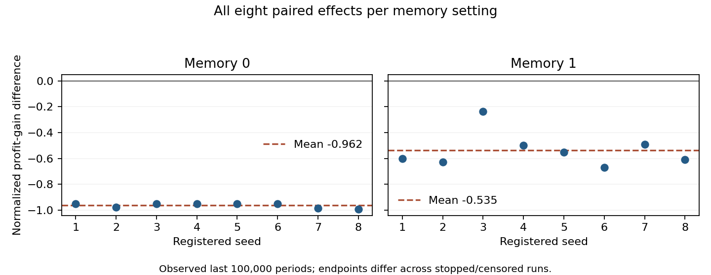

# Memoryless pricing: selective-feedback diagnostic

**Completed:** 2026-10-10. **Classification:** exploratory diagnostic, not a source-paper reproduction or equilibrium certification. **Baseline:** `fd06370b5e0f40670faafab10e155044ef493f65`. Production runtime source is unchanged.

The user approved following up on whether stale price scores and selective updating explain the memoryless variant's high profits. The approved probe used eight fixed seeds in four configurations, at most two million completed periods each, with the normal early-convergence rule retained. The question, matrix, analysis conventions, source and executable were frozen before execution.

## Finding

For all eight memoryless seeds, updating every alternative price using counterfactual profits substantially reduced observed late prices and profits. The selected-price-only updater often retained a high greedy price despite a currently more profitable lower price. The trace shows out-of-date and incompletely adjusted action scores, including differently dated future-value estimates. Broad selective-feedback/score-tracking explanations receive strong support in this matrix.

The intervention changes feedback coverage, update frequency and subsequent market trajectories together. It does not uniquely identify one mechanism. Price-history-based retaliation is unnecessary for this memoryless outcome; no stronger conclusion about other algorithms, markets or papers follows.

## Frozen setup and stopping

Seeds 1–8 crossed memory 0/1 and `Update::Asynchronous`/`Update::Synchronous`, 32 keys. Other settings are `CollusionConfig::default`: two firms, 15 Calvano-grid prices, cost 1, quality 2, outside 0, mu 0.25, alpha 0.15, delta 0.95, exponential exploration decay beta 4e-6, Calvano initialization, lowest-price ties and project RNG. The normal unchanged-strategy convergence window is 100,000. Eight seeds are descriptive replication attempts, not a power calculation.

The external loop stopped at exactly 2,000,000 completed periods, leaving native cap 1,000,000,000 unchanged. This avoids native `t > cap` off-by-one execution and final greedy rollback. Early-finished sessions were not extended with frozen prices; horizon-censored sessions were not assigned invented converged outcomes. All 32 keys completed normally, totaling 59,239,388 periods and 118,478,776 firm opportunities.

| Memory | Update feedback | Converged | Horizon-censored | Completed periods per run |
| --- | --- | ---: | ---: | --- |
| 0 | Chosen price | 5 | 3 | 1,777,428–2,000,000 |
| 0 | Every price | 0 | 8 | 2,000,000 |
| 1 | Chosen price | 6 | 2 | 1,573,130–2,000,000 |
| 1 | Every price | 6 | 2 | 1,074,140–2,000,000 |

All eight memoryless full-feedback sessions remained horizon-censored. Their low observed prices are not a claimed converged endpoint.

## Observed last 100,000 periods

Each run's tail contains its last 100,000 actual observed periods. Tables average the two firms within each seed, then all eight seeds equally. End times differ between stopped/censored runs. Absolute 100,000-period blocks and missing-window denominators are retained separately.

| Memory | Update feedback | Mean actual price | Mean normalized profit gain | Mean immediate greedy regret | Profitable lower-price opportunities |
| --- | --- | ---: | ---: | ---: | ---: |
| 0 | Chosen price | 1.829997 | 0.938851 | 0.044987 | 99.9687% |
| 0 | Every price | 1.466607 | -0.023513 | 0.000008872 | 0.0985% |
| 1 | Chosen price | 1.789339 | 0.850561 | 0.037730 | 99.6830% |
| 1 | Every price | 1.568398 | 0.315108 | 0.004757 | 80.1567% |

Prices are model units. The continuous competitive benchmark is approximately 1.47293; the joint-monopoly price is approximately 1.92498. The slightly negative full-feedback memoryless gain means profits below the continuous competitive benchmark, not negative actual profit. The finite price grid includes 1.46647 near that benchmark.

Normalized profit gain measures `(observed profit - competitive profit)/(joint-monopoly profit - competitive profit)`. Immediate greedy regret is the profit available from the best current alternative minus the profit from the greedy price, against actual rival actions. For memory 1, this is descriptive: different next-state continuation values can justify an immediate-profit sacrifice. Full learned Bellman-target regret is recorded separately and does not certify true optimal values.

For memory 0, the joint event of a profitable lower price AND the firm actually choosing its greedy price occurred on 99.9160% of tail opportunities with chosen-only feedback, versus 0.0984375% with full feedback. Regret against rival greedy prices also fell from 0.044980 to 0.000001151, so the main discrepancy is not merely a response to isolated exploratory rival moves. On opportunities with a profitable lower alternative, its mean update age fell from 16,103 periods to 1 period. No such tail alternative was never updated: delayed/incomplete tracking, not complete failure ever to try it, is the relevant distinction.

| Seed | Tail gain difference, memory 0 | Tail gain difference, memory 1 |
| --- | ---: | ---: |
| 1 | -0.949345 | -0.600318 |
| 2 | -0.975791 | -0.627314 |
| 3 | -0.949358 | -0.235925 |
| 4 | -0.949517 | -0.498467 |
| 5 | -0.949410 | -0.551613 |
| 6 | -0.949388 | -0.668973 |
| 7 | -0.984342 | -0.491451 |
| 8 | -0.991761 | -0.609567 |
| Mean | **-0.962364** | **-0.535453** |

Differences are every-price minus chosen-price feedback. All eight paired tail price/gain differences were negative at both memory settings. This does not mean every diagnostic improved in every seed: memory 1's joint lower-opportunity/greedy-choice fraction fell in six of eight seeds and rose in seeds 2 and 7.

A supplementary, retrospectively selected latest common fully observed absolute block—periods 900,001–1,000,000—also showed lower prices in all eight seeds at both memory settings and lower memory 0 gains in all eight. Memory1 gain fell in seven of eight there, with seed 5 increasing about 0.00206. This time-aligned check supports the memoryless direction while limiting universal wording about the reference arm; it is not a newly registered endpoint or new run.

## What the score histories establish

The observer runs after action selection and before Q writes. Q/greedy records are pre-update; epsilon has already decayed for the next choice. Update timestamps/counts advance for every actual update, including zero-change updates. Never-updated cells are flagged separately. Each cell retains its last reward, bootstrap term, old Q, target and rival profile. Current-state full 15-action rows are sampled every 1,000 periods, with bounded event windows and a horizon frame; every opportunity contributes to totals, absolute blocks and the rolling tail. Suppressed event starts are counted. All 61,511 retained frames (123,022 firm rows) were validated independently.

In memory 0, every current action has the same continuation value. Current target rankings therefore equal current immediate-profit rankings. Under full feedback, score differences obey

`Q_new(a)-Q_new(b) = (1-alpha)*(Q_old(a)-Q_old(b)) + alpha*(reward(a)-reward(b))`.

The common bootstrap cancels in each simultaneous update. Under chosen-only feedback, different action scores contain updates from different dates, with different rewards and future-value estimates. They need not be comparable estimates of current alternatives.

An illustrative saved tail frame, selected after analysis, makes this concrete. At memory 0/chosen-only seed 1 period 1,678,000, firm 0 chooses greedy action 10. Lower action 5 would earn 0.369758 versus 0.329041, but its stored Q is 6.170790 versus the greedy score 6.573901. It was last updated 571 periods earlier. Since that update, its current reward rose by 0.148751 and its bootstrap term by 0.370387. The resulting lower-action target residual is approximately-0.444173. Historical future-value drift is materially present even though current continuation terms cancel across actions.

The residual also includes incomplete adjustment of old Q toward the last target. Other sampled frames had zero latest reward drift or negative bootstrap drift while still undervaluing a lower price. Thus latest immediate-payoff staleness alone is not a complete explanation. The exact decomposition is:

`Q_now - target_now = (1-alpha)*(Q_before_last_update - target_last) + (reward_last - reward_now) + (bootstrap_last - bootstrap_now)`.

All three terms are retained. The intervention and examples support broad stale/selectively updated score tracking, not a claim that one residual component universally dominates.

## Verification, review and preservation

Temporary instrumentation lived only in detached worktree `collusion-memoryless-spike`. Its reference transition is byte-for-byte the original `fd06370` method. The observed method adds one immutable callback. Trace neutrality checks compare all private dynamic state and subsequent exploration/tie draws over the 32 short configuration/seed histories. A deliberate test-only extra RNG draw produced behavioral RED; normal execution passed GREEN. The earlier missing-method compiler failure is preserved as scaffold failure, not behavioral RED.

Required checks passed 45 collusion units, three observer/invariant tests, one probe accumulator test, four short 1,001-period fixture validations and formatting. The optional disposable core suite completed 3,149 passed/0 failed/seven existing ignored, exit0. Independent pre-run review and independent three-library/one-probe tests passed. Final native executable SHA256 is `46d721719709147fc1067ecc1550f0892cb869b0c346a8234461eb8253b81487`; final world/probe source hashes are `bb129528096346454a103582527b579ae7b12f2a7618dd10ef76471c4ef25234` and `3efa3e4c45674d4b4d7b287092f531216655a7b31db74c3711e9c7f0c28003b4`. One test-only formatting change was verified token-equivalent and followed by fresh focused checks; all source versions/logs remain preserved.

The saved-only analyzer validates all 32 keys, 96 raw hashes/sizes, actual defaults, stopping/denominator rules, sampled logit profits/continuation targets, final update counts/ages and memory 0 identities. Six synthetic tests pass. Two fresh analyses produce nine byte-identical files. Initial analysis outputs/code are preserved: the parser subsequently added the already-recorded joint metric and conditional age/drift comparisons; no raw data, thresholds or simulation parameters were changed. A wrong-working-directory shell attempt and original cropped plot are retained with their corrections. Independent findings review reconstructed 384 means and 192 paired cells within 1e-12, plus illustrative target-residual identities, with no substantive metric defect.

Primary evidence is preserved locally at `survey/out/collusion-memoryless-20261010/`, with its source copy at `/tmp/sugarscape-memoryless-spike-20261010/`. These retain scope/analysis/32-key manifest, pinned executable and source diff, test/fixture/review logs,96 raw files, index, both analyses, exact numerator/drift-denominator receipts, all eight pairs, absolute windows and plot source. Helper build artifacts remain separately archived before normal worktree cleanup. The completed root tracker is archived and retired. No production behavior, original scientific records or earlier interpretation register entries were overwritten; no push occurred.

## Limits and next question

This is eight seeds, one market/grid/learning-rate/exploration setup and a finite observed horizon. Censoring and different tail endpoints remain explicit. The updater changes feedback, frequency and trajectories jointly; true equilibrium, asymptotic convergence, biological applicability and real-market generalization are unestablished. Historical thousand-session results are context rather than acceptance targets.

A future experiment could separate refreshing immediate rewards from refreshing historical continuation estimates or changing update frequency. That would require a new fixed design and execution decision. The current spike is complete; it does not authorize extra arms or tuning.
